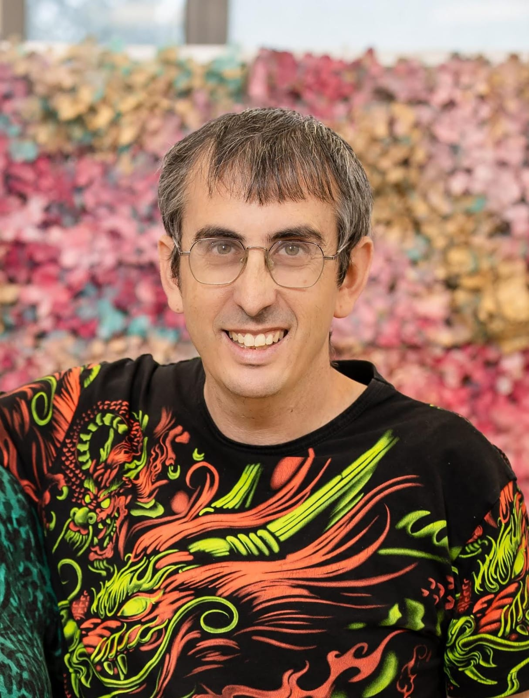

# About Me

{ width="250" }

<a href="https://github.com/Josh-Free" target="_blank" rel="noopener" title="GitHub"><svg xmlns="http://www.w3.org/2000/svg" viewBox="0 0 512 512"><path fill="currentColor" d="M216.5 362.5c-66-8-112.5-55.5-112.5-117 0-25 9-52 24-70-6.5-16.5-5.5-51.5 2-66 20-2.5 47 8 63 22.5 19-6 39-9 63.5-9s44.5 3 62.5 8.5c15.5-14 43-24.5 63-22 7 13.5 8 48.5 1.5 65.5 16 19 24.5 44.5 24.5 70.5 0 61.5-46.5 108-113.5 116.5 17 11 28.5 35 28.5 62.5v52c0 15 12.5 23.5 27.5 17.5C441 459.5 512 369 512 257 512 115.5 397 0 255.5 0S0 115.5 0 257c0 111 70.5 203 165.5 237.5 13.5 5 26.5-4 26.5-17.5v-40c-7 3-16 5-24 5-33 0-52.5-18-66.5-51.5-5.5-13.5-11.5-21.5-23-23-6-.5-8-3-8-6 0-6 10-10.5 20-10.5 14.5 0 27 9 40 27.5 10 14.5 20.5 21 33 21s20.5-4.5 32-16c8.5-8.5 15-16 21-21"/></svg></a>
<a href="https://www.linkedin.com/in/yehoshuapaul/" target="_blank" rel="noopener" title="LinkedIn"><svg xmlns="http://www.w3.org/2000/svg" viewBox="0 0 448 512"><path fill="currentColor" d="M416 32H31.9C14.3 32 0 46.5 0 64.3v383.4C0 465.5 14.3 480 31.9 480H416c17.6 0 32-14.5 32-32.3V64.3c0-17.8-14.4-32.3-32-32.3M135.4 416H69V202.2h66.5V416zM102.2 96a38.5 38.5 0 1 1 0 77 38.5 38.5 0 1 1 0-77m282.1 320h-66.4V312c0-24.8-.5-56.7-34.5-56.7-34.6 0-39.9 27-39.9 54.9V416h-66.4V202.2h63.7v29.2h.9c8.9-16.8 30.6-34.5 62.9-34.5 67.2 0 79.7 44.3 79.7 101.9z"/></svg></a>

I'm Yehoshua Paul, a senior technical writer with almost two decades of experience building documentation for B2B SaaS, enterprise software, cybersecurity, and cloud infrastructure platforms. I work in direct partnership with engineering teams and product management to translate complex technical details into clear, customer facing content. I currently work at Tufin  where I apply AI-assisted tooling to strengthen our documentation accuracy and reduce production time.

I've worked both as a lone writer where I handled the documentation needs of an entire company (including designing the features that needed to be documented), and I've been part of a team working in large enterprise companies. I have managed other writers, and also mentored junior writers just entering the field.

Throughout my career, I've made an effort to be an active contributor to the technical communication profession through industry conferences, publications, and leadership in tekom Israel.

I believe in making things better and in the power of communities. Documentation can always be improved. Also processes, and our fellow writers are the greatest resource we will ever have for accomplishing those goals. 